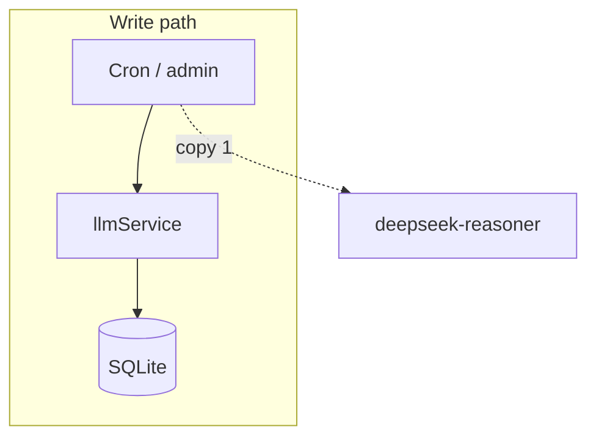

# Explainers — how these pages are built

Local HTML explainers (diff walkthroughs, architecture walk-throughs). `explainers/` is gitignored:
these are artifacts for a human to read, not shipped code.

If you are an agent asked to "make a visual explainer", **read this whole file first**. It records
what a previous session learned the hard way, so you do not rediscover it by shipping broken arrows.

## The one rule that matters

**Graphs are laid out by an engine, never by hand.**

A hand-placed SVG means someone typed `x="412" y="198"` for every box and every arrow endpoint. The
moment one label gets longer, or one node is added, the arrows point at nothing and nobody can tell
which coordinate is wrong by reading them. This has already happened in this repo.

So: a graph figure is a `flowchart` declaration. No coordinates. The renderer computes the geometry.

```html
<figure>
  <div class="ve-mermaid">

  </div>
  <figcaption><b>Fig 1a</b> — Before: …</figcaption>
</figure>
```

A hand-drawn SVG is allowed only when the drawing is not a boxes-and-arrows graph (a fixed-aspect
timeline with no edge endpoints to drift, for example), and only if a human agreed. Register it in
`scripts/check-explainers.mjs` under `ALLOWED_HAND_DRAWN` with a comment saying why.

## How to build one

Two commands, from the repo root:

```bash
# 1. write explainers/<name>.src.html, then render it (computes the layout, inlines the kit)
node ~/.cline/skills/visual-explainer/kit/render.mjs explainers/<name>.src.html --root ~/.cline/skills/visual-explainer

# 2. check the rules below hold
npm run check:explainers
```

`render.mjs` prints a visual check (smallest label size, sideways scrolling). **A passing visual
check is necessary, not sufficient** — it has passed on a page with a mid-word-wrapped node label. Open
the generated `sheet*.png` contact sheets and look at them.

`playwright-core` is required for the visual check. If it is missing:

```bash
npm install --no-save --prefix ~/.cline/skills/visual-explainer playwright-core
```

## Drawing a single figure

For one figure on its own — not a whole page — use the committed tool in `tools/diagrams/`:

```bash
node tools/diagrams/render.mjs tools/diagrams/figures/slop-meter-before.mmd \
  --out /tmp/fig1a --alt "Before state: …"

# optional: report labels that overlap a stroke or fall outside the canvas
node tools/diagrams/check.mjs tools/diagrams/figures/slop-meter-before.mmd
```

It renders a `.mmd` to inline-SVG and writes a ready-to-paste `<figure>` block. See
`tools/diagrams/README.md` for the traps it documents. `--alt` is not optional in spirit —
`contracts/design.md` requires alt text on images.

Both scripts use `chromium` from `@playwright/test`, which this repo already declares as a
devDependency. From the root, install it and its browser once:

```bash
npm install
npx playwright install chromium
```

## Rules the check enforces

| Rule | Why | Enforced by |
|---|---|---|
| Every graph is a `flowchart` block | Hand-typed coordinates drift into arrows pointing nowhere | `check-explainers.mjs` |
| Pele diagram ink pinned to the page ink | The kit points diagram text at `--text`, which is near-white in dark mode; Pele paints node pills light, so you get white-on-white | `check-explainers.mjs` |

## Rules the check cannot enforce — check these by eye

1. **Look at both colour schemes.** Render in light *and* dark (`prefers-color-scheme`). Diagram text
   and lane fills are computed at load time, so a light-only check proves nothing about dark mode.
   The dark-mode white-on-white bug above passed every light-mode screenshot.
2. **Do not fight the kit's own drawings.** No blanket `svg { width: 100% }` on kit figures. The kit
   emits a wide + narrow SVG pair and picks one. To fit a narrow column, let the figure *scroll*
   rather than shrink: a drawing scaled below ~1× drops its labels under the 12px floor.
3. **Check the fonts exist.** `fc-match 'Georgia'` on this box returns Noto Serif. A font stack whose
   faces are all missing silently falls back to something thin and glary. List an installed face.
4. **Undo the kit's `-webkit-font-smoothing: antialiased`** if body text looks haloed on a light
   background — set `auto`, and give the body a weight (`450`) rather than relying on faux-thin 400.
5. **Read the figcaptions against the drawing.** A previous session rewrote a caption to say "one
   name, not three" for a diagram showing two. Verify claims against the figure and against the code
   the caption cites.

## Regenerating a page

`.src.html` is the source of truth. The `.html` is generated — edit the source, re-render. Keep the
prose, tables and `TODO` comments from the source page verbatim; only the figure blocks change.
